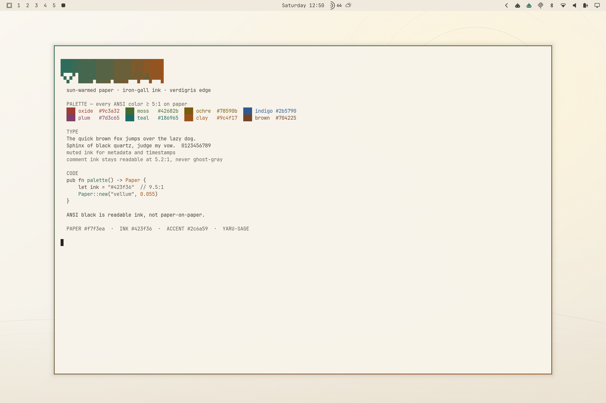
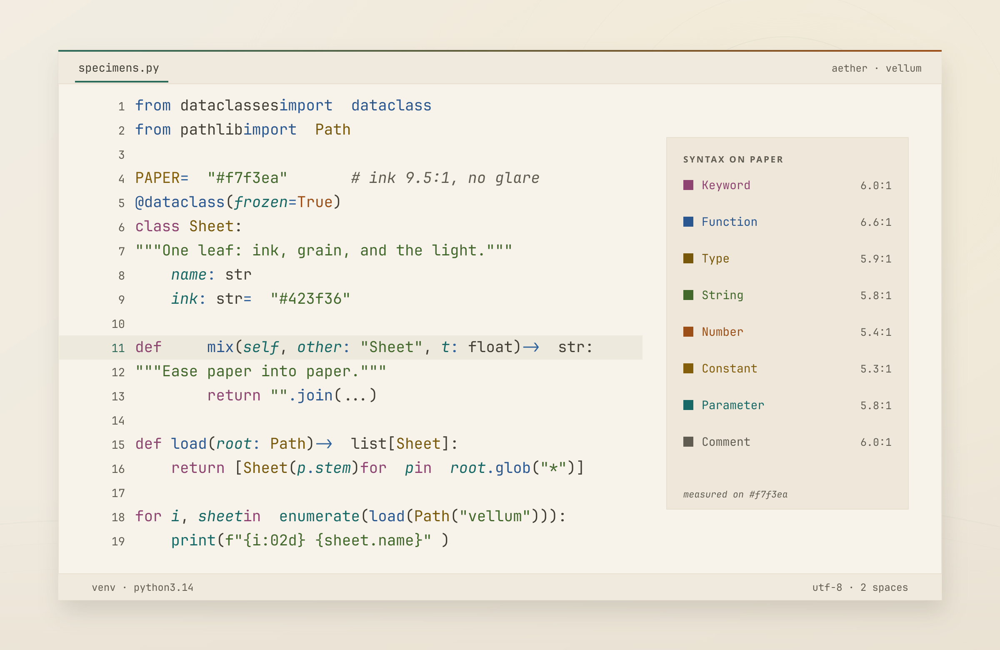
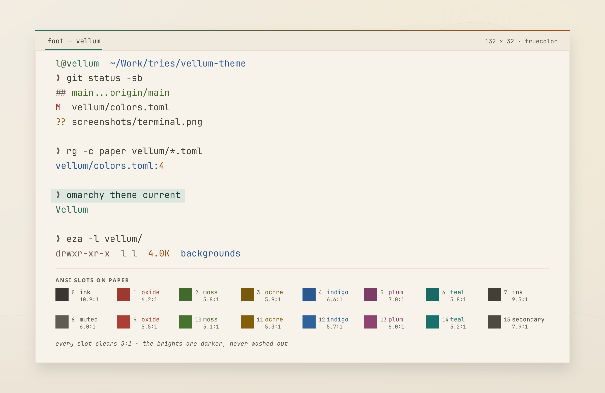
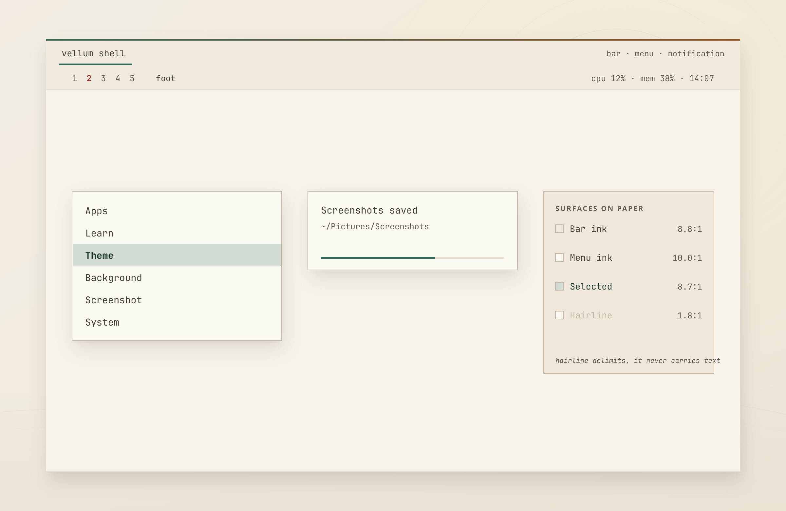
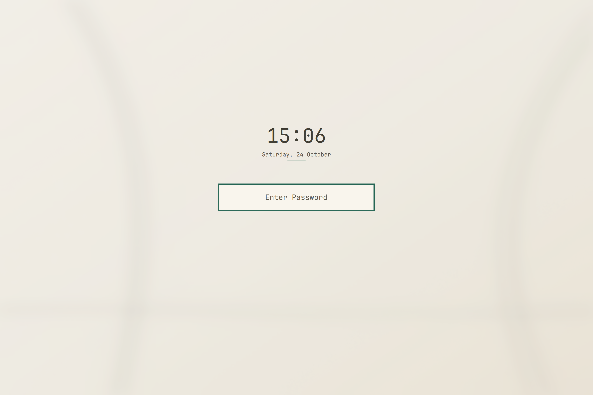

# Vellum

A light Omarchy theme: sun-warmed paper, iron-gall ink, a live verdigris edge.

Pure white burns; pure black rings. Vellum sits on `#f7f3ea` paper with warm
ink at 9.5:1 — crisp, but nowhere near near-black glare — a low-chroma verdigris
accent, and clay as the warm counterpoint. Text stays inside a 5–10:1 band:
body 9.5, secondary 8.0, muted 6.0, comments 5.2, syntax 5.1–7.6. Every ANSI
color, including the bright set, clears 5:1 on the page, so nothing disappears
and nothing burns.



## Palette

| Role | Hex | Contrast on paper |
|---|---|---|
| Paper | `#f7f3ea` | — |
| Ink | `#423f36` | 9.50:1 |
| Secondary ink | `#4f4a40` | 7.95:1 |
| Muted ink | `#615c51` | 6.00:1 |
| Comment ink | `#6b6558` | 5.23:1 |
| Verdigris accent | `#2c6a59` | 5.72:1 |
| Oxide red | `#9c3a32` | 6.19:1 |
| Clay / orange | `#9c4f17` | 5.35:1 |
| Ochre / yellow | `#78590b` | 5.87:1 |
| Moss / green | `#42682b` | 5.84:1 |
| Deep teal / cyan | `#186965` | 5.84:1 |
| Indigo / blue | `#2b5790` | 6.61:1 |
| Plum / magenta | `#7d3c65` | 7.01:1 |

The light-theme brights are deliberately darker, not washed out: the whole
bright set stays at 5.09:1 or better.

## In use

All three cards are drawn from the theme's own data — `colors.toml` for the
palette and the syntax roles Omarchy generates from it, `foot.ini` for the
terminal slots, `shell.toml` for the bar and popups — by
`tools/specimens.py`. The figures on the right are computed contrast, so the
page can be read at a glance: nothing burns in, nothing fades out.







## Surface logic

- Bar: `#f0eade`, one sheet deeper than the terminal paper.
- Cards, menus, notifications: `#fcf9f2`, one sheet lighter.
- Overlay scrim: warm ink at 30%, so light-theme modals gain depth instead of
  fading into the desktop.
- Menus select with a 20% verdigris fill and deep verdigris (`#1f3a33`) text,
  never a saturated block that would glare.
- Popup hairlines: `#c6baa4` (1.8:1 on the card). A light theme cannot separate
  a card from paper by fill alone, so the edge does that work — and only the
  edge: the delimiter never carries text.
- Focused windows: 2 px verdigris-to-clay gradient at 35°.
- Unfocused windows: `rgba(8a8375aa)`.
- Soft warm shadow (`range 18`, 15% ink) and Omarchy's square corners retained.

Icons use Yaru-sage. All other app themes (terminals, Helix, btop, VS Code,
Chromium, Obsidian, Claude, gum) are generated from `colors.toml` by Omarchy,
so the palette reaches every surface.

`foot.ini` is the one hand-written terminal config: Omarchy's generic template
maps ANSI black to the background, which makes explicit black text disappear on
a light theme. Vellum keeps `regular0` at readable ink (`#38362e`) and bright
black at muted (`#615c51`). New Foot windows pick this up immediately.

`neovim.lua` is the second: Aether only takes the colours, so Neovim stayed on
`background=dark` with a transparent popup menu and a `PmenuSel` that left ink
at 1.9:1 — the menu row you could not read. Vellum's file parses `colors.toml`
at startup (no second copy of the palette) and pins the popup ladder the
palette needs — page, bar-deep menu, mist selection, ink text — on every
`ColorScheme`. Because it replaces Omarchy's generated file, re-copy it from
the theme if a future Omarchy template gains new keys.

## Lock + suspend (optional)

The lock screen is a first-party Quickshell view: a blurred wallpaper plus a
password field. A theme cannot animate it or add content through `shell.toml`;
`[lock]` only styles the field card. `lock/` is a companion that clones
`omarchy.lock` and replaces only its visual `LockView.qml` — the cloned
`Service.qml` (PAM and session lock) stays exactly as Omarchy ships it.



```bash
bash lock/install.sh
omarchy-shell lock preview       # safe preview, no real lock
omarchy-shell lock hidePreview
```

It adds:

- a large `HH:mm` clock and date above the field;
- a 700 ms entry: wallpaper settles from 1.06×, blur eases from 1.0 to 0.55,
  clock/field rise 12–14 px and fade in;
- a 40 s, 12.5 fps wallpaper drift (1.0 ↔ 1.025), with a 16 % paper veil so
  the field and clock keep contrast;
- a 240 ms error shake and a fingerprint pulse when a sensor is enrolled;
- on wake, a logind `PrepareForSleep(false)` replays the 700 ms entry once.
  `dbus-monitor` runs only while the lock view is shown, so there is no
  background listener when unlocked.

Lock and suspend share this view: `omarchy-sleep-lock.service` locks before
suspend, and the same `LockView` is shown on wake. The 12.5 fps drift measured
**3–4 % of one core** while the lock preview was open.

The clone lives at `~/.config/omarchy/plugins/$USER.lock` and survives shell
updates; after an Omarchy update, re-run `bash lock/install.sh` so the cloned
`Service.qml` is refreshed and the visual is reapplied. To restore the built-in
lock, run `bash lock/uninstall.sh`.

The separate Plymouth boot/unlock screen has a new `vellum/unlock.png`
(800×188, `#2c6a59` wordmark). Apply it with:

```bash
sudo omarchy-plymouth-set-by-theme vellum
```

## Motion (optional)

The wallpaper itself is static; `plugin/` is a companion Omarchy shell service
that adds a slow, local two-ripple breath inside the dawn sun. It is separate
from the theme because themes are data-only — QML in a theme directory is never
loaded by the shell.

```bash
mkdir -p ~/.config/omarchy/plugins
cp -r plugin ~/.config/omarchy/plugins/local.vellum-ambient
omarchy plugin validate ~/.config/omarchy/plugins/local.vellum-ambient
omarchy plugin enable local.vellum-ambient
omarchy restart shell
omarchy-shell vellum.ambient status
```

- Only visible on `0-dawn`; switching to `1-ripple` or `2-strata` hides it.
- 12 s loop: warm clay primary + faint verdigris echo, born 6.96 s / 5.04 s
  apart; ease-out expansion, 1.4 s attack, 10.6 s decay, 4.4 % breathing glow.
- 12.5 fps, procedural `Shape` geometry — no frame cache, and crisp at 2×.
- Pauses after 60 s idle, while locked, and while a fullscreen window is active.
- Measured here: **2.2 % of one core** active, **0.6 %** on a non-dawn background.
- The plugin directory must be a real copy: `omarchy plugin validate` rejects a
  symlinked plugin folder.
- Uninstall: `omarchy plugin disable local.vellum-ambient`, then remove
  `~/.config/omarchy/plugins/local.vellum-ambient`.

The service is intentionally not installed by `omarchy theme install`; after
updating `plugin/`, copy it again.

## Screenshots

- `screenshots/showcase.png` — dawn wallpaper, bar, floating terminal, palette card.
- `screenshots/syntax.png` — editor specimen: syntax roles with measured contrast.
- `screenshots/terminal.png` — foot session, selection, and the sixteen ANSI slots.
- `screenshots/surfaces.png` — bar, menu, notification and their measured pairs.
- `screenshots/neovim.png` — generated Aether/Neovim theme in a tiled terminal.
- `screenshots/menu.png` — root menu card and scrim.
- `screenshots/lock.png` — animated lock/suspend view with clock, date and field.

## Assets

- `vellum/colors.toml` — source palette.
- `vellum/shell.toml` — hand-tuned Omarchy shell surfaces.
- `vellum/hyprland.lua` — focus seam, shadows, groupbar.
- `vellum/foot.ini` — readable ANSI black for light-mode terminals.
- `vellum/neovim.lua` — palette plus the popup/float ladder Neovim needs.
- `vellum/backgrounds/` — `0-dawn`, `1-ripple`, `2-strata`, `3-fold` (2880×1920).
- `tools/make_backgrounds.py` — regenerates the wallpapers; pass a name to rebuild one.
- `tools/specimens.py` — regenerates the three specimen cards.
- `tools/backgrounds-src/` — editable SVG sources for the four wallpapers.
- `plugin/` — optional `local.vellum-ambient` service plugin for the dawn ripple.
- `plugin/Ambient.qml` — procedural 12.5 fps ripple with idle/lock/fullscreen pause.
- `lock/LockView.qml` — animated lock/suspend view (clock, entry, slow drift).
- `lock/install.sh` — clones `omarchy.lock` and installs the visual.
- `lock/uninstall.sh` — restores the built-in Omarchy lock.
- `vellum/unlock.png` — 800×188 Plymouth boot wordmark.
- `vellum/preview.png` — staged desktop capture used by the theme picker.
- `vellum/preview-unlock.png` — Plymouth boot preview.

## Backgrounds

The theme ships four backgrounds. Switch them without changing the theme:

```bash
omarchy theme bg current                 # e.g. Fold
omarchy theme bg next                    # cycle to the next background
omarchy theme bg set <absolute-path>     # set a specific image
omarchy theme bg-switcher                # open the picker
```

GUI: `SUPER + CTRL + SPACE` opens the Background switcher. Double-clicking an
empty desktop also opens it (left button for backgrounds, right button for the
theme switcher).

Extra images can live outside the theme: `omarchy theme bg install` opens
`~/.config/omarchy/backgrounds/vellum/`; files there join the cycle.

`3-fold` is generated by `python3 tools/make_backgrounds.py 3-fold`; omit the
name to rebuild all four.

## Install / try

```bash
ln -s "$PWD/vellum" ~/.config/omarchy/themes/vellum
omarchy theme set Vellum
```

Omarchy stages the theme into `~/.local/state/omarchy/current/theme`, generates
terminal/editor/app configs from `colors.toml`, then reloads the shell and
running terminals. This installs the theme data only; the optional motion
service in `plugin/` is installed separately (see **Motion**).

This repository is a source checkout, not a gallery payload: the theme lives in
`vellum/`. `omarchy theme install` expects theme files at the repository root,
so use the symlink above (or copy `vellum/` into
`~/.config/omarchy/themes/vellum`). It is not submitted to the Omarchy gallery.

## License

MIT — see [`LICENSE`](LICENSE). The wallpapers, previews and screenshots were
generated or captured for this theme.
